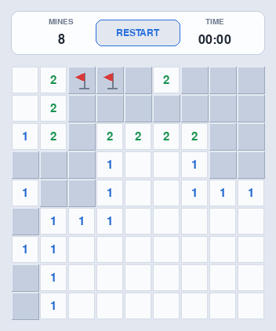
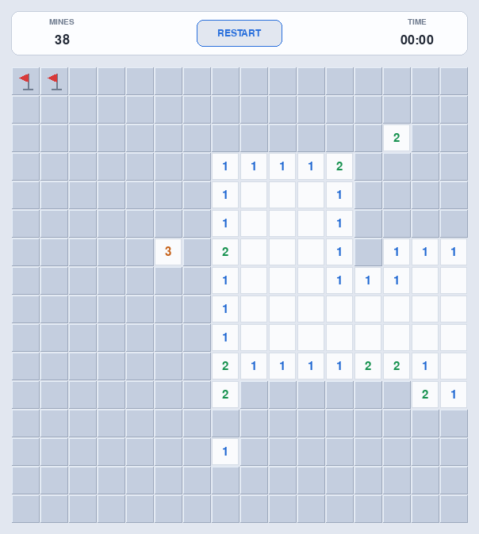
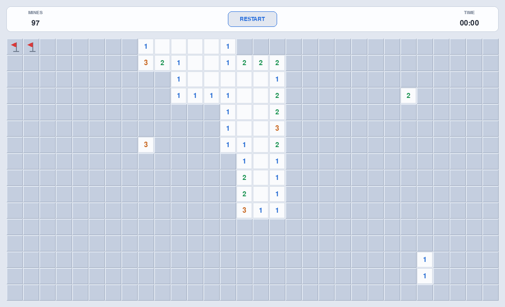
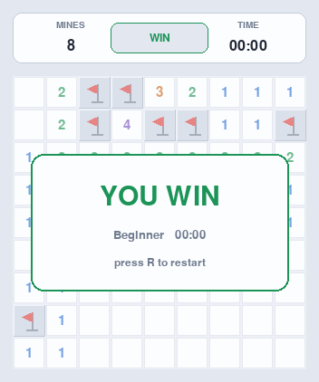
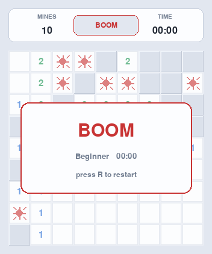

# Minesweeper Demo

用 **Python + pygame** 写的扫雷原型，目的不是"再做一个扫雷"，而是练**工程化**：
把规则、状态、渲染拆成互相不依赖的层，让逻辑能被单元测试覆盖，让加难度 / 换配色只改数据文件。



<details>
<summary>Intermediate 16×16 / Expert 16×30 预览</summary>




</details>

<details>
<summary>终局画面</summary>




失败时只做轻微蒙层，雷与数字仍然清晰，方便复盘；胜利时把所有雷标成旗子。

</details>

> 以上截图由 `python tools/shots.py` 自动生成，改配色后跑一次即可全套刷新。

---

## 功能

| 功能 | 说明 |
| --- | --- |
| 三档难度 | Beginner 9×9/10、Intermediate 16×16/40、Expert 16×30/99，写在 `config/levels.json` |
| 首次点击安全 | 延迟布雷：第一次点击之后才生成雷，且周围一圈留出安全区 |
| 空白连锁展开 | 点到 0 格时自动展开连通的空白区域，用**显式栈迭代**实现，大盘面不会递归溢出 |
| 插旗 | 右键插旗 / 取消旗，HUD 实时显示剩余雷数（可为负） |
| 双击和弦 | 在**已翻开的数字格**上双击，周围旗数等于该数字时一次翻开其余邻格；旗插错会踩雷（沿用经典规则，不做保护） |
| 计时 | 第一下点击才开始计时，进入终局后冻结 |
| 胜负判定 | 非雷格全开即胜；踩雷则失败并亮出全部雷 |
| 快捷键 | `R` 重开、`1/2/3` 切难度、`ESC` 退出 |
| 无窗口自检 | `--smoke` 不开窗渲染一帧并截图，可用于 CI 与交付前自检 |

## 快速开始

```bash
python -m venv .venv
# Windows
.venv\Scripts\activate
# macOS / Linux
# source .venv/bin/activate

pip install -r requirements.txt
python main.py
```

常用参数：

```bash
python main.py                        # 默认 beginner
python main.py --level intermediate   # 换难度
python main.py --seed 42              # 固定随机种子，局面可复现（调 bug 很有用）
python main.py --list-levels          # 只列出全部难度
python main.py --smoke                # 无窗口自检，输出 docs/preview.png
```

## 操作

| 输入 | 行为 |
| --- | --- |
| 左键 | 翻开格子 |
| 左键双击 | 在已翻开的数字格上和弦（400ms 内两次点击同一格） |
| 右键 | 插旗 / 取消旗 |
| `R` | 重开本局 |
| `1` `2` `3` | 切换难度 |
| `ESC` | 退出 |

---

## 目录结构

```
minesweeper-demo/
├── main.py                  # 入口：参数解析 → 载入配置 → 启动 UI
├── config/
│   └── levels.json          # 难度配置（数据驱动，改这里不用改代码）
├── minesweeper/
│   ├── config.py            # 配置读取 + LevelConfig 数据类
│   ├── core.py              # 纯规则：Board / Cell / 状态枚举（不 import pygame）
│   ├── game.py              # 对局状态：计时、重开
│   ├── theme.py             # 颜色 / 尺寸常量，改配色只动这一个文件
│   └── ui.py                # pygame 渲染与输入，只画图 + 转发操作
├── tests/
│   └── test_core.py         # 21 个单元测试，覆盖布雷、计数、洪水填充、胜负
├── docs/
│   ├── preview.png          # 预览图（tools/shots.py 生成）
│   ├── preview-intermediate.png
│   ├── preview-expert.png
│   ├── preview-win.png
│   ├── preview-lost.png
│   ├── REQUIREMENTS.md      # 需求规格 + 需求/实现/测试追踪矩阵
│   └── DEV_PLAN.md          # 迭代计划与提交规范
├── tools/
│   └── shots.py             # 批量生成预览图（无窗口，可用于 CI）
├── assets/
│   └── README.md            # 素材来源与授权说明（当前无外部素材）
├── requirements.txt
└── .gitignore
```

## 架构：为什么要拆成这样

```
输入事件 ──► App.handle_event ──► Game ──► Board ──► App.draw
             (ui.py)           (game.py) (core.py)   (ui.py)
```

| 层 | 职责 | 依赖 |
| --- | --- | --- |
| `config.py` + `levels.json` | 难度参数 | 无 |
| `core.py` | 布雷、翻格、插旗、计数、胜负 | **不依赖 pygame**，可单独跑单测 |
| `game.py` | 当前对局：计时、重开、状态迁移 | 只依赖 core |
| `ui.py` | 画格子、处理鼠标键盘 | 依赖 pygame，但不做任何规则判断 |

这样拆的好处很实际：

1. **规则可测**：`core.py` 不碰窗口，21 个测试 0.03 秒跑完，改逻辑不怕回归；
2. **换皮容易**：配色全在 `theme.py`，改一套就是另一个风格；
3. **换前端容易**：想再做一个网页版，`core.py` 原样搬过去就能用。

### 几个具体技术点

- **延迟布雷 + 安全区**：`Board.reveal` 里第一次点击才调用 `_place_mines`，并把点击格及其八邻域排除在候选雷位之外。雷数太多、放不下安全区时自动退化为只保护点击格（`test_exact_mine_count_after_first_click` 守着这条）。
- **迭代式洪水填充**：`_flood_reveal` 用 `stack` 而不是递归，既避免了 16×30 大棋盘上的递归深度风险，也让展开顺序可控。
- **邻雷计数**：布雷后统一 `_recount_adjacent()` 全量重算（O(n)），比每插一颗雷增量更新更不容易出错。
- **插旗不参与展开**：洪水填充只处理 `HIDDEN` 状态，插旗格会被跳过，符合常见操作直觉。

## 测试

```bash
python -m unittest discover -s tests -t . -v
```

覆盖点：棋盘初始化与非法参数、首点必安全（50 个种子）、雷数精确性、邻雷计数与暴力算法逐格比对、
插旗状态机与旗格跳过、洪水填充边界（"数字墙"拦截）、踩雷与胜利判定、终局后输入失效、计时与种子复现、
双击和弦的触发条件与旗插错踩雷。

```
Ran 27 tests in 0.030s
OK
```

---

## 工程化约定

- **需求先行**：新功能先写进 `docs/REQUIREMENTS.md`（编号 + 优先级 + 可测试的验收标准），再进排期
- **提交信息**：Conventional Commits，例如 `feat(core): 首次点击安全区`、`fix(ui): 修正高 DPI 缩放`、`docs: 补充架构说明`
- **分支**：`main` 保持可运行；功能在 `feat/<主题>` 上开发，自测通过再合并
- **提交前自检**：`python -m unittest discover -s tests -t . -v` + `python main.py --smoke` 必须都过
- **不引入外部素材**：全部用 pygame 基础图元绘制，见 `assets/README.md`

## Roadmap

后续迭代（详见 [`docs/DEV_PLAN.md`](docs/DEV_PLAN.md)），需求清单与验收标准见 [`docs/REQUIREMENTS.md`](docs/REQUIREMENTS.md)：

- v0.2 双击和弦（数字格周围旗数足够时一次翻开剩余格）
- v0.3 本地最佳成绩与对局记录（JSON 存档）
- v0.4 自定义难度 + 主题切换 + 音效开关
- v1.0 一键复盘（导出每一步操作序列）

## 版权声明

本项目为个人学习演示，玩法参考经典扫雷规则；**代码、界面绘制、配色全部自行实现，不含任何第三方美术或音频素材**，不用于商业用途。
